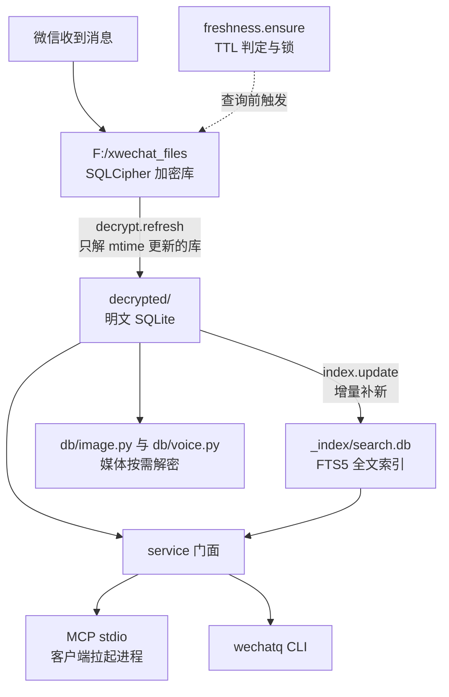

# 总体设计

描述当前已实现的状态，不是目标态。目标态与改造计划见 docs/重构方案-2026-11-13.md，待办见 docs/任务清单.md。

## 1 数据流

## 2 数据源与解密

| 项目 | 当前状态 |
|---|---|
| 微信源库 | F:\xwechat_files，账户目录 wxid_ 开头，db_storage 下按模块分目录 |
| 密钥 | keys.json，windows 页面级 SQLCipher4；提取脚本 scripts/extract_key_windows.py 与 decrypt_standalone.py |
| 解密输出 | decrypted/，按模块分目录：contact/contact.db、message/message_N.db、session/session.db 等 |
| 刷新 | 查询前自动增量，TTL 默认 60 秒；也可跑 quick_decrypt.py 或 wechatq sync |
| 增量可见性 | 只解源库 mtime 比副本新的库；微信未 checkpoint 的 WAL 内容任何方式都读不到 |
| 失败处理 | 解到临时文件校验后原子替换，失败保留旧副本；刷新出错不阻断查询 |
| 多账号 | 只解密有 keys.json 密钥的账号 |

## 3 模块职责

| 模块 | 行数 | 职责 |
|---|---|---|
| src/server.py | 68 | MCP 入口，只负责启动与注册工具 |
| src/mcp_tools.py | 257 | 七个 MCP 工具的参数校验与 JSON 包装 |
| src/service.py | 101 | service 门面，MCP 与 CLI 共用 |
| src/decrypt.py | 168 | 页级解密、增量刷新、原子替换 |
| src/freshness.py | 175 | 刷新链：TTL、锁、降级 |
| src/entities.py | 296 | 实体查询：群、人、会话与筛选、名称候选 |
| src/messages.py | 407 | 消息查询：游标分页、多目标、类型过滤、文件路径 |
| src/search.py | 107 | 实体与消息统一搜索 |
| src/moments.py | 193 | 朋友圈：XML 解析、筛选、评论与点赞挂载 |
| src/favorites.py | 175 | 收藏：XML 解析、类型与标签筛选 |
| src/relations.py | 271 | 群成员、共同群、跨群发言、单会话统计 |
| src/export.py | 170 | 导出 json/csv/md/html，分片写入，按进程隔离目录并做 12 小时清理 |
| src/media_files.py | 120 | 文件消息落盘路径解析 |
| src/media_inline.py | 93 | 图片字节提取、语音转写、按需落盘 |
| src/sync.py | 27 | 数据状态报告 |
| src/cli.py | 295 | wechatq 命令，与 MCP 同参 |
| src/index/__init__.py | 302 | FTS5 构建、增量水位、查询、候选表筛选 |
| src/report/ | 约 1000 | 年度报告：两遍扫描、指标、六份产物 |
| src/db/open_.py | 26 | 只读打开（immutable） |
| src/db/locator.py | 82 | 数据源定位，WDA 适配器接口预留 |
| src/db/sender.py | 91 | 发送者解析与显示名 |
| src/db/types.py | 78 | local_type 解包与 49 子类型 |
| src/db/image.py | 518 | 图片三源降级、DAT 与表情解密（供媒体内联） |
| src/db/voice.py | 150 | 语音转写（供媒体内联） |
| scripts/ | 3044 | 密钥提取、全量解密、快速解密、图片密钥 |

## 4 当前工具面（7 个）

| 工具 | 主要参数 | 说明 |
|---|---|---|
| list_entities | scope、keyword、since_days、only_group、only_unread、min_members、max_members、sort、limit、offset | 会话、联系人、群统一列表，带成员数、群主、公告、最后活跃 |
| get_messages | targets、sender、start_date、end_date、types、keyword、order、limit、cursor、output、format | 默认最新优先，游标分页，支持类型过滤与落盘导出 |
| relations | kind、subject、targets、since_date、until_date、limit | 群成员、共同群、某人在多群发言、单会话活跃统计 |
| search | query、scope、since_date、until_date、limit | 实体与消息一起搜，带命中片段 |
| sync | action、force | 数据新鲜度与刷新 |
| list_moments | author、keyword、since_date、until_date、limit、offset、with_interactions | 朋友圈动态与评论点赞 |
| list_favorites | type、keyword、tag、since_date、until_date、limit、offset | 收藏条目与标签 |

## 5 数据可得性

数据库里有什么、没有什么，是设计的地基。以下是 2026-11-13 对本机解密库的实际核查结果。

| 信息 | 可得性 | 位置 |
|---|---|---|
| 消息正文、发送者、时间、类型 | 可得 | message_N.db 的 Msg_<md5> 表 |
| 群成员关系 | 可得，4.0 万行覆盖 740 群 | contact.db chatroom_member |
| 群主 | 可得 | contact.db chat_room.owner |
| 群公告 | 可得，39% 非空 | contact.db chat_room_info_detail.announcement_ |
| 群管理员 | 不可得 | 全库无角色列 |
| 群昵称（群内显示名） | 不可得 | 本地未存 |
| 联系人备注、昵称、微信号 | 可得 | contact 表 alias、remark、nick_name |
| 联系人地区、签名 | 需解 protobuf，尽力 | contact.extra_buffer |
| 联系人标签 | 表存在但缺绑定 | contact_label 20 条，无关联表 |
| 好友验证、转账、红包 | 可得 | general.db FMessageTable、transferTable、redEnvelopeTable |
| 朋友圈 | 可得，已接入 list_moments | sns.db 3095 条动态、1099 条互动 |
| 收藏 | 可得，已接入 list_favorites | favorite.db 198 条、32 标签、49 条绑定 |
| 好友地区 | 可得，覆盖 1030/1389 好友 | contact.extra_buffer 字段 5/6/7 |
| 好友添加时间 | 部分可得 | contact.extra_buffer 字段 41 |
| 文件消息落盘路径 | 可得，未接入 | hardlink.db file_hardlink_info_v4 1582 条 |
| 语音原始数据 | 可得 | message/media_N.db VoiceInfo 5715 条 |
| @提及 | 不可得结构化字段 | 只能从正文解析字面量 |

## 6 性能与配额

| 项目 | 实测或现状 |
|---|---|
| 消息总量 | 1,422,927 条，12 个 message 分库，约 3140 张 Msg_ 会话分表 |
| 读取速度 | 读库并解压 zstd 约 29.4 万条每秒 |
| 全量解密 | 32 库 983 MB 用 10 到 11.5 秒，约 112 MB 每秒 |
| 增量解密 | 最近 24 小时变化的 12 库 149.7 MB 用 2.47 秒；单个活跃消息库 0.32 秒 |
| 首查询开销 | stdio 握手 1.0 到 1.6 秒；带刷新首次查询 1.5 到 1.7 秒，TTL 内 0.3 到 1 秒 |
| FTS5 写入 | 约 11.9 万条每秒，索引约 26.5 MB 每 19.7 万条 |
| 单次返回上限 | 会话消息 500 条、搜索 200 条、最近消息 500 条 |
| 已有硬编码 | 每会话 50 条、统计 2000 条、全局搜索每表 500 行、Top50 会话 |

## 7 范围外

不在范围：自身定时轮询（已改为查询前懒刷新）、发送消息、客户端界面自动化、把 WeChatDataAnalysis 作为主数据源。

## 8 文件树

完整文件树、每个文件的职责与入库状态见 AGENTS.md 的「文件树」一节。本文件不重复维护树结构，避免两处不一致。
