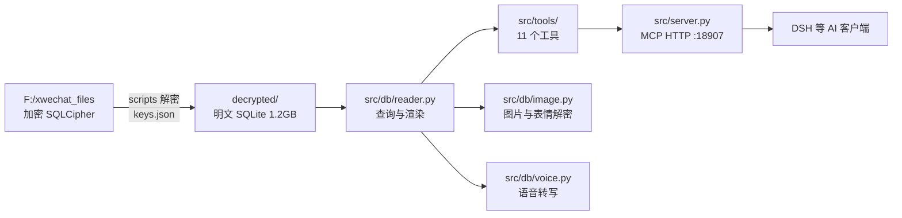

# 总体设计

描述当前已实现的状态，不是目标态。目标态与改造计划见 docs/重构方案-2026-11-13.md，待办见 docs/任务清单.md。

## 1 数据流

## 2 数据源与解密

| 项目 | 当前状态 |
|---|---|
| 微信源库 | F:\xwechat_files，账户目录 wxid_ 开头，db_storage 下按模块分目录 |
| 密钥 | keys.json，windows 页面级 SQLCipher4；提取脚本 scripts/extract_key_windows.py 与 decrypt_standalone.py |
| 解密输出 | decrypted/，按模块分目录：contact/contact.db、message/message_N.db、session/session.db 等 |
| 刷新 | start.ps1 调 quick_decrypt.py，整库重新解密，约 1 到 2 分钟 |
| 增量可见性 | 60 秒冷却，只在工具调用时检查源库 mtime；微信未 checkpoint 的 WAL 内容任何方式都读不到 |
| 多账号 | 只解密有 keys.json 密钥的账号 |

## 3 模块职责

| 模块 | 行数 | 职责 |
|---|---|---|
| src/server.py | 696 | MCP 工具注册、reader 选择、惰性增量同步 |
| src/db/reader.py | 952 | 本地 SQLite 查询：联系人、会话、消息、搜索、成员、统计 |
| src/db/models.py | 140 | Contact、Message、Session 数据模型与文本渲染 |
| src/db/image.py | 518 | 图片三源降级、V2 DAT 解密、表情 aeskey 解密、wxgf 首帧 |
| src/db/voice.py | 150 | sherpa-onnx 加 SenseVoiceSmall int8 本地转写与指纹缓存 |
| src/db/windows_reader.py | 581 | HTTP 回退：调用 WeChatDataAnalysis 的 4 个端点 |
| src/tools/ | 767 | 工具实现：contacts 124、messages 430、summary 213 |
| src/config.py | 130 | 路径发现、解密目录检查、密钥读写 |
| scripts/ | 3044 | 密钥提取、全量解密、快速解密、图片密钥 |

## 4 当前工具面（11 个）

| 工具 | 主要参数 | 说明 |
|---|---|---|
| check_status | 无 | 数据源体检 |
| list_contacts | keyword、include_groups、limit | 联系人与群列表 |
| find_contact | name | 单个联系人 |
| list_group_members | group_name、only_with_wechat_id、limit | 群成员公开资料 |
| get_sessions | limit | 最近会话 |
| get_chat_history | contact_name、start_date、end_date、limit、offset、output_format | 会话消息 |
| search_messages | keyword、contact_name、contact_names、start_date、end_date、limit | 关键词搜索 |
| get_recent_messages | days、group_only、limit、output_format、chat_names | 最近 N 天 |
| export_voice | contact_name、local_id | 单条语音导出 |
| summarize_chat | contact_name、period、start_date、end_date | 单会话统计 |
| chat_stats_overview | period、top_n | 跨会话总览 |

## 5 数据可得性

数据库里有什么、没有什么，是设计的地基。以下是 2026-11-13 对本机解密库的实际核查结果。

| 信息 | 可得性 | 位置 |
|---|---|---|
| 消息正文、发送者、时间、类型 | 可得 | message_N.db 的 Msg_<md5> 表 |
| 群成员关系 | 可得，4.0 万行覆盖 739 群 | contact.db chatroom_member |
| 群主 | 可得 | contact.db chat_room.owner |
| 群公告 | 可得，39% 非空 | contact.db chat_room_info_detail.announcement_ |
| 群管理员 | 不可得 | 全库无角色列 |
| 群昵称（群内显示名） | 不可得 | 本地未存 |
| 联系人备注、昵称、微信号 | 可得 | contact 表 alias、remark、nick_name |
| 联系人地区、签名 | 需解 protobuf，尽力 | contact.extra_buffer |
| 联系人标签 | 表存在但缺绑定 | contact_label 20 条，无关联表 |
| 好友验证、转账、红包 | 可得 | general.db FMessageTable、transferTable、redEnvelopeTable |
| 朋友圈 | 可得，未接入 | sns.db 3095 条动态、1099 条互动 |
| 收藏 | 可得，未接入 | favorite.db 198 条、32 标签 |
| 文件消息落盘路径 | 可得，未接入 | hardlink.db file_hardlink_info_v4 1582 条 |
| 语音原始数据 | 可得 | message/media_N.db VoiceInfo 5715 条 |
| @提及 | 不可得结构化字段 | 只能从正文解析字面量 |

## 6 性能与配额

| 项目 | 实测或现状 |
|---|---|
| 消息总量 | 1,422,927 条，12 个 message 分库，约 3140 张 Msg_ 会话分表 |
| 读取速度 | 读库并解压 zstd 约 29.4 万条每秒 |
| FTS5 写入 | 约 11.9 万条每秒，索引约 26.5 MB 每 19.7 万条 |
| 单次返回上限 | 会话消息 500 条、搜索 200 条、最近消息 500 条 |
| 已有硬编码 | 每会话 50 条、统计 2000 条、全局搜索每表 500 行、Top50 会话 |

## 7 范围外

朋友圈、收藏、近实时监听、发送消息、客户端界面自动化、把 WeChatDataAnalysis 作为主数据源。这些都不在当前实现里，是否纳入见任务清单与重构方案。
