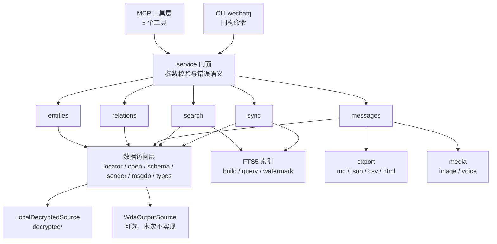

# wechat-msg-mcp 重构方案

状态：已实施到阶段 8（2026-11-14）
日期：2026-11-13
对象：D:\Github\wechat-msg-mcp

本文件是本次重构的唯一方案依据。实施过程中按阶段更新状态；全部完成后，有效内容并入 AGENTS.md 与长期设计文档，讨论记录由 Git 历史保存，本文件按文档规范删除。

阅读提示：第 5 节写的是当时的 5 工具设计；阶段 7 增加了朋友圈与收藏，现为 7 个工具；阶段 8 把传输改为 stdio 自启动、解密改为增量、查询前自动刷新，细节在第 19 节。当前实现以 docs/总体设计.md 为准。

业务需求来源：docs/业务场景与程序不匹配.md（2026-11-13 由业务复盘产出，记录 M1 至 M10 共 10 处不匹配，提交 a99b273）。本方案已吸收其全部条目，对应关系见 2.1 节。真实群名与复现参数只保存在 private-docs/（已在 .gitignore 中），本文件与公开文档只写脱敏结论。

## 1 背景

现有数据的实际规模（2026-11-13 实测）：

| 项目 | 数量 |
|---|---|
| 消息总数 | 1,422,927 条 |
| message 分库 | 12 个（message_0 至 message_10 加 message_resource） |
| Msg_ 会话分表 | 约 3140 张 |
| 联系人 | 33372 |
| 群成员关系 | 40000 行，覆盖 739 个群 |
| 会话 | 2140 |
| 解密后体积 | 约 1.2 GB |

现有 11 个工具的具体缺陷（读码实证）：

| 编号 | 问题 | 现象 | 出处 |
|---|---|---|---|
| P1 | 全局搜索只扫每会话表最新 500 行 | 历史深处内容搜不到，命中够数就跳过后续分库 | reader.py:811、834-844、788-789 |
| P2 | 统计类取升序前 2000 条 | 长窗口只统计前段，结果偏小且不报警 | summary.py:70 |
| P3 | 最近 N 天取窗口内最早 50 条 | 与工具名语义相反，大群返回的是窗口开头 | reader.py:926-930、683-687 |
| P4 | 跨分库 offset 分页 | 会话跨多个库时漏条或重复 | reader.py:683-687、746-747 |
| P5 | 群维度缺失 | 没有成员数、群主、公告，无法按规模或活跃筛群 | models.py:22-28 |
| P6 | 无交叉查询 | 共同群、某人在多群发言只能逐群调 N 次 | 无对应实现 |
| P7 | 无导出 | 几百上千条结果只能塞进 MCP 返回体 | 无对应实现 |
| P8 | 类型 49 混为一类 | 链接、文件、小程序、视频号无法区分 | models.py:10-19 |
| P9 | HTTP 回退模式残缺 | 仅 4 个端点，无群成员、语音、导出 | windows_reader.py |
| P10 | 联系人信息面窄 | 只有 wxid、备注、昵称、是否群 | models.py:22-28 |

## 2 目标与边界

用户要的能力归为四类，另有三个横向需求：

| 类别 | 具体 | 说明 |
|---|---|---|
| 清单 | 我有多少群、多少单聊，每个对象的基本信息与最新动态 | 支持按时间、规模、未读、类型筛选 |
| 成员 | 某个群有哪些人，每个人是什么样的人 | 备注、昵称、微信号、地区、签名、与我的关系 |
| 消息 | 某个会话里有什么消息，支持条件筛选 | 时间、发言人、类型、关键词、方向 |
| 交叉 | 我和某人的共同群、某人在多群发言、跨群活跃 | 关系视角的聚合查询 |
| 导出 | 大结果落文件 | 避免 MCP 返回体爆炸 |
| CLI | 与 MCP 完全同构 | 支持批处理与年度报告 |
| 报告 | 2025 年度综合统计 | 一次性跑出多份产物 |

本次做：实体、关系、消息、搜索、同步、索引、导出、CLI、年度报告、类型解析。

本次不做：朋友圈、收藏、近实时监听、发送消息、客户端界面自动化、WDA 作为主数据源。朋友圈与收藏留到二期。

### 2.1 业务侧不匹配与本方案的对应

优先级与状态以 docs/任务清单.md 为准，本表只说明设计落点。

| 编号 | 业务侧问题 | 本方案的落点 | 所属阶段 |
|---|---|---|---|
| M1 | 默认按时间升序取最早 N 条，看不到最新进展 | get_messages 默认 order=desc，导出时强制 asc | 阶段 2 |
| M2 | 返回头写“共 N 条”但没有 total 与 has_more | 所有列表返回 total、returned、has_more、next_offset | 阶段 2 |
| M3 | 会话横跨多个分库时 offset 翻页重复或漏条 | 弃用 offset，改用四元组游标 | 阶段 1 |
| M4 | 多目标查询每群硬编码 50 条，失败被静默跳过 | per_target_limit 可配置，失败目标进 unresolved 列表 | 阶段 2 |
| M5 | 学员群随阶段改名，旧名查询直接失效 | 名称解析三级：精确、模糊、候选列表 | 阶段 1 |
| M6 | 没有成员到群的反向索引，做不了共同群与跨群汇总 | relations 的 common_groups 与 person_activity | 阶段 3 |
| M7 | 长窗口统计只算升序前 2000 条，偏小且不报警 | 聚合下推到 SQL，按时间窗 GROUP BY | 阶段 3 |
| M8 | 数据可能停在昨日，返回体不标截止时间 | 所有返回带 data_cutoff，session.db 纳入同步 | 阶段 1 |
| M9 | 文本与内联图片一起返回，单次数万字符被宿主截断 | include_media=false 只给路径，inline 阈值 80 KB | 阶段 2 |
| M10 | 学员发的合同、表格拿不到落盘路径 | 接 hardlink 文件表，types=file 可查可导出 | 阶段 3，从二期提前 |

## 3 已确认决策

| 编号 | 决策 | 理由 |
|---|---|---|
| D1 | 保留现有解密链路与 keys.json，不换解密来源 | 本机已验证可用，11-12 还成功刷新过全量数据 |
| D2 | 保留媒体层 image.py 与 voice.py | 图片三源降级、表情解密、语音转写都是踩坑所得 |
| D3 | 删除 windows_reader.py 及 HTTP 回退分支 | 只有 4 个端点，从未触发，带 bug 的死代码 |
| D4 | 数据源做成可插拔，本次不实现 WDA 适配器 | 用户决定先不装 WDA，保留以后接入的可能 |
| D5 | 工具面收敛为 5 个 | 参数组合覆盖原 11 个工具的能力 |
| D6 | 建 FTS5 本地索引 | 实测构建 8-10 秒、约 130 MB，查询毫秒级 |
| D7 | 年度报告走 CLI 子命令 | 不需要 AI 参与，批处理更合适 |
| D8 | 系统消息与撤回不计入聊天句数 | 避免群活跃度被加群踢人撤回刷高 |
| D9 | 新增好友用 protobuf 添加时间近似 | 好友验证表仅 123 条，覆盖不全，报告须标注口径 |
| D10 | 朋友圈与收藏二期再做 | 用户当前用不上 |
| D11 | 导出做成参数而非独立工具 | 控制工具数量，导出本质是输出形态 |
| D12 | 保留顶层包名 src，不重命名仓库与包 | 避免破坏 pyproject 入口、脚本引用与 DSH 注册 |
| D13 | 查询默认最新优先，导出默认时间升序 | 业务要的是最新进展，归档要的是时间顺序 |
| D14 | 目标名解析失败时返回候选而不是空结果 | 学员群会改名，空结果无法区分“不存在”与“无消息” |
| D15 | 公开文档脱敏，真实名称只进 private-docs | 仓库是公开的，聊天数据涉及学员隐私 |

## 4 目标架构



目标目录结构（保留 src 作为顶层包）：

```text
src/
  config.py              路径与环境变量，保留
  server.py              仅保留 MCP 启动入口
  mcp_tools.py           5 个工具的薄壳注册
  service.py             service 门面，MCP 与 CLI 共用
  cli.py                 wechatq 命令
  entities.py            实体查询
  relations.py           关系查询
  messages.py            消息查询
  search.py              实体与消息搜索
  sync.py                刷新与增量
  export.py              导出
  db/
    locator.py           数据源定位（本地 / WDA 输出）
    open_.py             只读连接与 WAL 处理
    schema.py            表名与列名常量
    sender.py            Name2Id 发送者解析（自 reader.py 抽取）
    msgdb.py             Msg_ 表定位、跨库遍历、稳定分页
    types.py             local_type 解包与子类型识别
  index/
    build.py             FTS5 构建
    query.py             查询构造
    watermark.py         增量水位
  media/
    image.py             自 db/image.py 迁入
    voice.py             自 db/voice.py 迁入
  report/
    annual.py            年度报告入口
    metrics.py           指标实现
scripts/                 解密脚本原样保留
docs/                    本方案与后续长期文档
```

删除清单：src/db/reader.py（查询逻辑被 entities/relations/messages 取代，三个技巧先抽取）、src/db/windows_reader.py、src/tools/。

## 5 数据模型

统一的实体模型，人和群共用一套字段，按 kind 区分。

| 字段 | 类型 | 人 | 群 | 来源 |
|---|---|---|---|---|
| id | str | wxid | xxx@chatroom | contact.username |
| kind | person/group | 是 | 是 | contact.local_type 与后缀 |
| name | str | 备注优先，其次昵称 | 群名 | contact.remark / nick_name |
| nickname | str | 微信昵称 | 群名 | contact.nick_name |
| alias | str | 自定义微信号 | 空 | contact.alias |
| region | str | 地区 | 空 | contact.extra_buffer 解析，尽力 |
| signature | str | 签名 | 空 | contact.extra_buffer |
| is_friend | bool 或 null | 好友判定 | null | contact.local_type |
| member_count | int 或 null | null | 群成员数 | chatroom_member 计数 |
| owner_id | str 或 null | null | 群主 | chat_room.owner |
| notice | str 或 null | null | 群公告 | chat_room_info_detail.announcement_ |
| last_active_at | str | 最后消息时间 | 同 | session 表或 Msg_ 聚合 |
| last_message | str | 最后一条摘要 | 同 | session 表 |
| unread | int | 未读数 | 同 | session 表 |

消息模型：

| 字段 | 说明 |
|---|---|
| local_id, server_id | 消息标识，local_id 在单个 Msg_ 表内唯一 |
| create_time | 秒级时间戳 |
| direction | in 或 out |
| sender_id, sender_name | 群消息为真实发送者，私聊为对方 |
| type, subtype | 主类型与 49 的子类型，见第 11 节 |
| text | 文本正文，媒体消息为空 |
| media | 图片、语音、视频的定位信息（md5、local_id、时长、大小） |

明确不可得的三项，设计里不再出现：群管理员（本地无角色列）、群昵称（本地不存）、@提及结构化字段（只能从正文解析字面量）。

## 6 MCP 工具契约

### 6.1 list_entities

列出会话、联系人或群，统一带元信息。

| 参数 | 类型 | 默认 | 说明 |
|---|---|---|---|
| scope | session/contact/group/all | session | 数据范围 |
| keyword | str | 空 | 匹配名称、备注、昵称、wxid |
| since_days | int | 0 | 仅返回该天数内有消息的实体，0 为不限 |
| only_group | bool | false | 仅群 |
| only_unread | bool | false | 仅有未读 |
| min_members / max_members | int | 0 | 群成员数区间 |
| sort | last_time/members/name | last_time | 排序 |
| limit / offset | int | 100 / 0 | 分页 |
| output | inline/file | inline | 超过阈值自动转文件 |

返回：

```json
{"total": 739, "returned": 100, "has_more": true, "next_offset": 100,
 "entities": [{"id":"xxx@chatroom","kind":"group","name":"项目群","remark":"","nickname":"项目群",
  "alias":"","region":"","is_friend":null,"member_count":312,"owner_id":"wxid_x",
  "notice":"...","last_active_at":"2026-11-12 20:10:11","last_message":"...","unread":3}]}
```

### 6.2 get_messages

读取消息，targets 为空表示全库。

| 参数 | 说明 |
|---|---|
| targets | 会话名或 ID 的列表，可混人与群，留空为全部 |
| sender | 发言人（wxid、备注或昵称），用于某人在多群的发言 |
| start / end | YYYY-MM-DD，含首尾 |
| types | text/image/voice/video/emoticon/file/link/miniprogram/quote/redpacket/transfer/location/system 的子集 |
| keyword | 正文子串，可选 |
| order | asc 或 desc，默认 desc，导出时强制 asc |
| limit / offset | 默认 200，单次上限 1000 |
| per_target_limit | 多目标时每个目标的上限，默认 50，可调 |
| output | inline/file |
| format | md/json/csv/html，output=file 时生效 |
| include_media | bool，默认 true；false 时只给媒体路径与标记，返回体控制在 80 KB 内 |

返回 inline：

```json
{"total": 1832, "returned": 200, "has_more": true, "next_offset": 200,
 "data_cutoff":"2026-11-13 22:07:48",
 "messages": [{"local_id":123456,"time":"2025-03-01 12:00:00","direction":"in",
  "type":"text","subtype":null,"sender_id":"wxid_a","sender_name":"张三",
  "chat_id":"xxx@chatroom","chat_name":"项目群","text":"...",
  "media":null}],
 "unresolved": [{"input":"AI游戏-亦可-体验2","reason":"not_found",
  "candidates":[{"id":"56180833489@chatroom","name":"AI游戏-08-亦可-体验4","distance":"high"}]}]}
```

返回 file：

```json
{"exported": true, "path":"exports/messages-20261113-2210.csv", "format":"csv",
 "rows":5821,"bytes":7340032,"range":["2025-01-01 00:00:00","2025-12-31 23:59:59"]}
```

### 6.3 relations

关系查询，一个工具四个方向。

| kind | subject | targets | 返回 |
|---|---|---|---|
| group_members | 群 | 不用 | 群信息加成员列表 |
| common_groups | 人 | 不用 | 共同群列表，含群规模、我的发言数 |
| person_activity | 人 | 可选群清单 | 每群发言数、最后发言时间、占比；targets 省略即全部群 |
| activity | 群或人 | 不用 | 时间窗内条数、按天与按小时的分布、类型分布、Top 发言人 |

公共参数：since、until、limit。

返回示例（person_activity）：

```json
{"person":{"id":"wxid_a","name":"张三"},
 "scope":{"targets":"all_groups","groups_scanned":739},
 "total":1832,
 "groups":[{"id":"xxx@chatroom","name":"项目群","messages":412,"share":0.031,
  "last_at":"2026-11-12 18:22:00"}]}
```

### 6.4 search

一次查询同时覆盖消息与实体。

| 参数 | 说明 |
|---|---|
| query | 关键词，多个词为 AND |
| scope | message/entity/all，默认 all |
| kinds | 实体类型过滤 person/group，可选 |
| since / until | 时间窗 |
| limit | 每组上限，默认 30 |
| output | inline/file |

返回：

```json
{"entities":[{"id":"wxid_b","kind":"person","name":"合同复印店","matched":"remark"}],
 "messages":[{"local_id":1,"time":"...","chat_id":"...","chat_name":"...",
  "sender_name":"...","snippet":"...关键词前后 40 字..."}],
 "counts":{"entities":1,"messages":37}}
```

### 6.5 sync

| 参数 | 说明 |
|---|---|
| action | status 或 sync |
| force | 忽略冷却强制刷新 |
| only | message/contact/session/hardlink/all，默认 all |

返回：

```json
{"state":"ok","last_sync":"2026-11-13 22:08:00","lag_seconds":12,
 "dbs":[{"db":"message_2.db","mtime":"2026-11-13 22:07:48","new_rows":37}],
 "index":{"rows":951233,"updated_at":"2026-11-13 22:08:00"}}
```

所有工具与 CLI 的返回顶部统一带 data_cutoff（解密数据截止时间，取源库最新 mtime），用于回答“我看到的是不是最新”。目标名解析不到时返回 unresolved 与候选，不用空结果冒充无消息。

## 7 CLI 契约

命令与参数和 MCP 完全同构，由同一 service 层实现。

| 命令 | 等价 MCP 调用 |
|---|---|
| wechatq list --scope group --since-days 30 --sort members | list_entities |
| wechatq messages --targets 项目群 --sender 张三 --types voice,file | get_messages |
| wechatq rel group-members --subject 项目群 | relations |
| wechatq rel common-groups --subject 张三 | relations |
| wechatq rel person-activity --subject 张三 --targets 群A,群B | relations |
| wechatq search 合同 --scope all | search |
| wechatq sync --force | sync |
| wechatq report annual --year 2025 --out reports/2025 | 无对应，CLI 独有 |

CLI 额外能力：

| 能力 | 说明 |
|---|---|
| 批处理 | --all-groups 或 --stdin 传入清单，逐项执行并汇总 |
| JSON 输出 | 全局开关 --json，便于管道与后续分析 |
| 文件输出 | 默认把大结果写文件并打印路径 |
| 退出码 | 0 成功，2 参数错误，3 数据未就绪，4 目标不存在 |

## 8 索引设计

索引库位置：decrypted/_index/search.db（不进入 Git）。

表结构：

```sql
CREATE VIRTUAL TABLE msg_fts USING fts5(text, tokenize='unicode61');
CREATE TABLE msg_meta(rowid INTEGER PRIMARY KEY, db TEXT, tbl TEXT, local_id INTEGER,
  chat_id TEXT, sender_id TEXT, ts INTEGER, type INTEGER);
CREATE TABLE watermark(db TEXT, tbl TEXT, max_local_id INTEGER, PRIMARY KEY(db,tbl));
CREATE TABLE token_stats(token TEXT PRIMARY KEY, doc_count INTEGER);
CREATE INDEX idx_meta_chat_ts ON msg_meta(chat_id, ts);
CREATE INDEX idx_meta_sender_ts ON msg_meta(sender_id, ts);
```

写入规则：

| 项目 | 做法 |
|---|---|
| 中文分词 | 逐字加空格写入，查询时每个词同样转成逐字短语，实现子串匹配 |
| 批量 | 每 2000 条提交一次，构建时 journal_mode=OFF、synchronous=OFF、cache 128MB |
| 增量 | sync 之后按 watermark 中每张 Msg_ 表的 max_local_id 只插新行 |
| 原子切换 | 全量重建写临时文件，完成后 os.replace |
| 高频单字 | 词长 1 且 doc_count 超过 2000 时走 instr 加时间索引探测，避免 FTS 全排序 |

实测数据（2026-11-13，基于 message_2.db）：

| 指标 | 实测 |
|---|---|
| 读库并解压 | 294,000 条每秒 |
| FTS5 写入 | 119,000 条每秒 |
| 索引体积 | 26.5 MB / 197,168 条 |
| 全量推断 | 约 95 万文本行，构建 8-10 秒，索引约 130 MB |
| 关键词查询 | 5 次查询合计小于 0.01 秒 |
| 增量更新 | 每日数千条，亚秒级 |

## 9 导出设计

| 项目 | 规则 |
|---|---|
| 触发 | output=file，或 inline 结果超过 500 条或 80 KB 时自动转文件 |
| 目录 | 项目内 exports/，按 exports/<类型>-<时间戳>-<序号>.<后缀> |
| 格式 | json（全字段）、csv（每条一行，utf-8-sig）、md（人读）、html（带媒体引用） |
| 分片 | 超过 5 万行自动切分多个文件，文件名带序号 |
| 内存 | 分批读取与写入，不一次性加载全量 |
| 媒体 | 只写路径，不复制文件；复制媒体留到二期 |
| 列 | 时间、方向、会话、发送者、类型、子类型、长度、local_id、db、表名 |

## 10 年度报告

命令：wechatq report annual --year 2025 --out reports/2025

指标分组：

| 板块 | 指标 | 数据来源 |
|---|---|---|
| 总览 | 总条数、发送与接收、活跃天数、首末消息、单聊与群聊占比 | message 全库 |
| 按人 | 每人接收与发送条数、占比、首末时间、活跃天数、我发的比例 | Msg_ 加 sender 解析 |
| 按群 | 每群总条数、我的条数、我的占比、Top 发言人、活跃天数 | Msg_ 加 chatroom_member |
| 类型 | 各类型条数与占比、语音总时长、文件扩展名 Top | 类型解析 |
| 时间 | 按月、按周、按小时、按星期分布，最忙一天，深夜占比，最长连续聊天天数 | create_time |
| 新增关系 | 新增好友与新增活跃群，标注近似口径 | general.db FMessageTable 加 protobuf 添加时间 |
| 极端值 | 最长消息、单日峰值、回复间隔中位数 | 全量 |

产出：

| 文件 | 内容 |
|---|---|
| report.json | 全部聚合指标 |
| people.csv | 每个联系人的发收统计 |
| groups.csv | 每个群的统计与 Top 发言人 |
| monthly.csv | 月份与类型交叉表 |
| messages.csv | 全量明细，供二次分析 |
| report.md | 一页摘要 |

性能目标：全量 142 万条在 3 分钟内跑完，分库分批处理。

## 11 类型解析

local_type 是 64 位打包值：主类型取低 32 位，子类型取高 32 位。例如 244813135921 等于 57 左移 32 位再加 49，表示 49 主类型的 57 子类型引用消息。

| 主类型 | 含义 | 处理 |
|---|---|---|
| 1 | 文本 | 直接取正文 |
| 3 | 图片 | 解析 md5 与 local_id，走媒体层 |
| 34 | 语音 | 解析时长，走转写 |
| 43 | 视频 | 解析时长与封面 |
| 47 | 表情 | 走表情解密 |
| 48 | 位置 | 解析经纬度与名称 |
| 49 | 应用消息 | 按 appmsg 的 type 再分：5 链接、6 文件、19 合并转发、33 小程序、51 视频号、57 引用、62 与 63 视频号变体 |
| 10000 | 系统消息 | 单列，不计入聊天句数 |
| 10002 | 撤回状态 | 单列 |

未知类型保留原始值并标 unknown，不丢弃。

## 12 数据源抽象

接口原型：

```python
class DataSource(Protocol):
    def detect(self) -> dict        # 可用性、账号、路径、最后刷新时间
    def path(self, kind: str) -> Path   # kind: contact/session/message/media/hardlink/general
    def message_dbs(self) -> list[Path]
```

两个实现：

| 实现 | 状态 | 说明 |
|---|---|---|
| LocalDecryptedSource | 本次实现 | 读 decrypted/，按模块分目录：contact/contact.db、message/message_0.db |
| WdaOutputSource | 本次不实现，保留接口 | 读 WDA 的 output/databases/账号，扁平目录，需要把文件名映射到 kind |

约定：所有连接以只读模式打开，不复制明文到其他目录，不修改源文件；同目录的 -wal 与 -shm 由刷新流程负责。

## 13 旧工具迁移映射

| 旧工具 | 新工具与调用方式 |
|---|---|
| check_status | sync(action=status) |
| list_contacts | list_entities(scope=contact) |
| find_contact | list_entities(scope=contact, keyword=名称) |
| get_sessions | list_entities(scope=session) |
| list_group_members | relations(kind=group_members, subject=群) |
| get_chat_history | get_messages(targets=[目标]) |
| search_messages | search(query=关键词, scope=message) |
| get_recent_messages | get_messages(start=今天减 N 天) 或 list_entities(since_days=N) |
| export_voice | get_messages(types=voice, include_media=true, output=file) |
| summarize_chat | relations(kind=activity, subject=目标) |
| chat_stats_overview | list_entities(scope=session, sort=last_time, since_days=7) 加 relations(kind=activity) 批量统计 |

这是一次破坏式升级：不保留旧工具名。同步重写 USAGE-DSH.md 与 README 的工具章节。

## 14 实施阶段与验收

| 阶段 | 交付 | 验收 |
|---|---|---|
| 1 骨架 | locator、open、schema、sender、msgdb、types、service 门面、sync、list_entities、名称候选解析、data_cutoff | 能列出 739 个群并带成员数、群主、最后活跃时间；用旧群名查询返回候选而非空；返回体带数据截止时间（M5、M8） |
| 2 查询与索引 | messages、search、index 三件套、游标分页、多目标与配额控制 | 59 条的群 limit=10 返回最新 10 条且带 has_more；跨两个分库的会话翻页无重复无遗漏；25 个群 3 天窗口单次完成或明确分批，失败目标单列；include_media=false 时返回体小于 80 KB（M1、M2、M3、M4、M9） |
| 3 关系与类型 | relations 四个方向、类型解析、文件消息路径 | 群成员与共同群结果可抽验；某人在多群发言与身份核对吻合；types=file 能列出文件消息并给出落盘路径与扩展名（M6、M7、M10） |
| 4 导出与报告 | export、cli 批处理、report annual | 导出 5000 条 CSV 行数与时间范围正确；年度报告六份产物齐全，总条数与 sync status 一致 |
| 5 收尾 | 删除 reader 与 windows_reader 与 tools、重写文档、回归 | 旧工具全部下线，DSH 重新 mcp_load 后 5 个工具可用；USAGE-DSH.md 更新 |

每阶段结束提交一次 Git，并更新本文件状态。

## 15 风险与缓解

| 风险 | 影响 | 缓解 |
|---|---|---|
| 发送者解析回归 | 群消息张冠李戴 | 先抽 sender.py 再删 reader.py，用旧工具输出对拍 |
| 跨库分页不稳 | 漏条或重复 | 统一以 (ts, db, tbl, local_id) 四元组作为游标，不再用 offset |
| 索引与刷新竞态 | 索引落后或重复 | 索引水位与 sync 串行，写入加锁 |
| 大结果导出内存 | 进程被杀 | 分片与分批写，单批 5000 行 |
| 密钥失效 | 全盘查询失败 | 保留既有诊断路径，报错指向 decrypt_standalone.py |
| 隐私 | 日志泄露内容 | 日志只写条数与耗时，不写正文与 wxid |
| 类型解析不全 | 小众类型标 unknown | 保留原值，报告里单列未知类型 |

## 16 二期范围

| 项目 | 数据现状 |
|---|---|
| 朋友圈 | sns/sns.db 11 张表，3095 条动态，1099 条评论点赞 |
| 收藏 | favorite/favorite.db 198 条，32 个标签，49 条绑定 |
| 群公告展示 | chat_room_info_detail 745 条，39% 非空 |
| 头像 | head_image 2424 张 |
| WDA 适配器 | 接口预留，需要时实现 |

## 17 文档与流程

| 时点 | 动作 |
|---|---|
| 本稿确认时 | 提交 Git，作为可恢复的方案版本 |
| 业务清单处置 | docs/业务场景与程序不匹配.md 的 M1 至 M10 已并入 2.1 节，该文件修复完成后转为开发日志条目并删除 |
| 真实数据规则 | 真实群名、群ID、金额、截图路径只写 private-docs/，公开文档一律脱敏；private-docs 已在 .gitignore 中，禁止 git add -f |
| 每阶段完成 | 更新本文件状态、写开发日志 |
| 全部完成 | 方案内容并入 AGENTS.md 与长期设计文档，删除本稿，Git 历史保留原文 |

## 18 阶段 7：朋友圈、收藏与联系人地区

状态：已完成并验收（2026-11-13）。

本阶段补完剩余数据面，不改已有五个工具的语义，只新增两个工具与两个字段。

### 18.1 新增工具 list_moments

数据源：decrypted/sns/sns.db。SnsTimeLine 共 3095 条，content 为 SnsDataItem/TimelineObject XML；SnsMessage_tmp3 共 1099 条，type=2 且 content 非空为评论，type=1 为点赞类记录。

参数：author（人/自己，可选）、keyword、since_date、until_date、limit、offset、with_interactions（默认 true）。

返回：每条含 tid、author_id、author_name、time、text、media（类型与 url）、likes（昵称列表）、comments（评论人、内容、时间）、comment_count、like_count，以及 total、has_more、data_cutoff。

### 18.2 新增工具 list_favorites

数据源：decrypted/favorite/favorite.db。fav_db_item 198 条，content 为 favitem XML；fav_tag_db_item 32 个标签，fav_bind_tag_db_item 49 条绑定。

参数：type（link/text/image/video/file/voice/chat_record/note）、keyword、tag、since_date、until_date、limit、offset。

返回：每条含 local_id、type、title、desc、url、source_chat、source_user、time、tags，以及 total、has_more、data_cutoff。

### 18.3 联系人地区与添加时间（T14）

contact.extra_buffer 是 protobuf，实测顶层字段 5=国家（CN）、6=省（Zhejiang）、7=市（Hangzhou），字段 41 为添加时间 epoch。list_entities 新增 region、add_time 两个字段，取不到时为空串，并标注为尽力而为。

### 18.4 验收

| 项 | 标准 |
|---|---|
| 朋友圈 | 能按人、时间、关键词查，评论与点赞能对上；空结果给 total=0 |
| 收藏 | 能按类型、关键词、标签筛选，链接能给出标题与 URL |
| 地区 | 至少一半以上好友有省份与城市，取不到时为空不报错 |
| 兼容 | 既有五个工具参数与返回不变 |

## 19 阶段 8：自动刷新与 stdio 自启动（2026-11-14）

### 19.1 要解决的问题

现状要求先跑 start.ps1 解密加建索引，再起 http 服务，最后才 mcp_load。数据新鲜度完全取决于有没有人手动跑这一步，工具本身不知道源库变了。

实测证据：2026-11-14 08:28:57 收到一条消息，08:25 解密的库里没有；08:29 微信把新页写进主库后，再跑一次解密才读到。中间的空窗没有人负责填补。

### 19.2 目标

| 编号 | 目标 |
|---|---|
| G1 | AI 侧只需一次 mcp_load，服务由客户端拉起，不依赖外部脚本、不占端口 |
| G2 | 查询前自动拉到最新，AI 也能显式要求立刻刷新 |

### 19.3 决策

| 决策点 | 选择 | 依据 |
|---|---|---|
| 传输方式 | stdio 作为默认与推荐 | 客户端负责 spawn，实测进程起到 initialize 握手 1.60 秒，7 工具全在；http 保留但不再需要预先启动 |
| 刷新触发 | 懒刷新加 TTL，默认 60 秒，加 force 强制 | 只在有人查的时候花钱；轮询每 30 秒要读 132 MB，每小时约 15.8 GB 空转 |
| 解密范围 | 只解 mtime 比解密副本新的库 | 全量 32 库 983 MB 需 11.5 秒；最近 24 小时有变化的 12 库 149.7 MB 仅 2.47 秒 |
| 落盘方式 | 解到临时文件，校验可读，再 os.replace 原子替换 | 现写法直接覆盖，中途失败会把旧文件删掉 |
| 并发 | 锁文件加持有超时，抢不到就用现有数据并如实标注 | stdio 下多客户端各起一个进程 |
| 索引 | 解密确有变化才跑增量 | 增量 0.39 秒，不必每次付 |

### 19.4 接口

| 入口 | 用法 |
|---|---|
| 环境变量 | WECHAT_REFRESH_TTL 秒；0 表示每次查询前都刷；负数表示关闭自动刷新 |
| MCP | sync(action="sync", force=True) 强制刷新；status 不变 |
| CLI | wechatq refresh 强制刷新；查询类子命令加 --fresh 立即刷新一次 |

### 19.5 返回契约

查询类结果新增 refresh 字段，保持透明：

| 字段 | 含义 |
|---|---|
| refreshed | 本次是否执行了刷新 |
| changed_dbs | 实际重新解密的库名列表 |
| seconds | 刷新耗时 |
| skipped | 未刷新原因：ttl、locked、disabled、error |
| ttl_left | 距下次允许刷新还有多少秒 |

失败不阻断查询：刷新出错时照常返回现有数据，把错误写进 refresh.error。

### 19.6 验收

| 项 | 标准 |
|---|---|
| 自启动 | 注册为 stdio 后，mcp_load 不依赖外部进程即可列出 7 个工具 |
| 新鲜度 | 微信写入新消息后，一次查询即可读到，无需手动跑脚本 |
| TTL | 60 秒内连续查询只刷新一次，可观测 ttl_left 递减 |
| 强制刷新 | force=True 无视 TTL 立即刷新 |
| 安全 | 解密失败不损坏既有解密副本 |
| 并发 | 两个进程同时刷新时只有一个执行，另一个复用结果 |
| 不回归 | 原有 32 项单测通过，工具参数与既有字段不变 |

## 20 阶段 9：导出隔离与多实例共存（2026-11-14）

### 20.1 问题

实测本机常有两个 src.server 进程同时存活（08:55:08 同一秒起了两个），所以导出不能假设单实例。

| 现状问题 | 后果 |
|---|---|
| 只有 get_messages 支持落盘 | 其余六个工具的大结果只能塞进响应体 |
| 文件名精确到秒 | 同一秒内两次导出会覆盖 |
| 没有清理 | exports/ 只增不减 |
| 所有进程写同一个 exports/ | A 启动时清理会删掉 B 正在用的文件 |

### 20.2 决策

| 决策点 | 选择 | 依据 |
|---|---|---|
| 目录隔离 | 每进程写 exports/run-<pid>-<启动时间>/ | 实测两个进程 run 目录不同，物理上不可能互删 |
| 清理策略 | 启动时扫 exports/，删超过 12 小时的文件（run 目录与旧版本散落在根目录的都算），再删空目录 | 按时间兜底，不按进程存活判断；进程退出不立即删，给 AI 读文件留缓冲 |
| AI 指定目录 | output_dir 参数，绝对路径优先 | 指定目录不参与清理，程序不碰自己管不到的地方 |
| 文件名 | 时间戳加进程内自增序号 | 同秒不撞名；跨进程靠目录隔离 |
| 阈值 | 200 行或 80 KB，全工具统一 | 与既有 get_messages 口径一致 |
| 预览 | 落盘后只保留前 3 条 | 响应体可控，AI 需要全量时读文件 |

### 20.3 接口

六个查询工具（list_entities、get_messages、relations、search、list_moments、list_favorites）统一支持：

| 参数 | 取值 | 说明 |
|---|---|---|
| output | inline 或 file | file 强制落盘 |
| output_dir | 路径 | 留空写本进程 run 目录 |
| format | json/csv/md/html | get_messages 默认 csv，其余默认 json |

返回里出现 export 或 auto_export 字段，含 path、files、rows、bytes，自动落盘时多一个 reason。

### 20.4 验收

| 项 | 实测 |
|---|---|
| 进程隔离 | 两个进程 run 目录分别为 run-40528-* 与 run-36600-* |
| 12 小时清理 | 13 小时前的假目录被删（removed_files=1, removed_dirs=1），1 分钟前的不动 |
| 同秒不覆盖 | 连续三次落盘得到 -0001、-0002、-0003 三个文件，同时存在 |
| 指定目录 | output_dir 生效，路径落在指定目录下 |
| 阈值触发 | list_entities 300 条与 get_messages 250 条都自动落盘并只回 3 条预览 |
| 未达阈值 | search 150 条不落盘，直接返回 |
